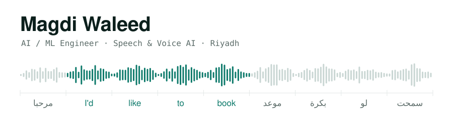

<!-- Generated by tools/build.py from sections/. Edit those files, not this one. -->

<picture>
  <source media="(prefers-color-scheme: dark)" srcset="assets/header-dark.svg">
  
</picture>

I build speech recognition and voice agents that work in Arabic, including the messy part where people switch to English mid-sentence. Most of my week goes to [Nabrah.ai](https://nabrah.ai): training and evaluating ASR models, serving them fast enough for live calls, and the agents that sit on top.

[LinkedIn](https://www.linkedin.com/in/magdi-waleed/) · [YouTube](https://www.youtube.com/@mAIStudentJourney) · [Email](mailto:m.w.m.khalafallah@gmail.com)

### Now

- **Arabic / English ASR.** Fine-tuning, decoding (beam vs. greedy), and streaming inference on Triton and GCP. I benchmark every model across SADA, Casablanca, MGB-2, MASC and Common Voice, and break the errors down by dialect, recording environment, gender and age, because one average WER hides where a model fails.
- **Voice and WhatsApp agents.** Phone and chat agents built on [LiveKit Agents](https://github.com/livekit/agents): latency, turn-taking, handoffs, and making sure an agent that says "booked" actually booked.
- **Making that work repeatable.** Shared tooling for the team: one package for text normalization and metrics, and Claude skills that build and audit agents from a company brief.

### Selected work

**Nabrah ASR** · private, in production 
Bilingual Arabic / English speech recognition with code-switching, streamed through Triton on GCP GPUs. 41% lower WER than Whisper large-v3, at 19× its real-time factor. 
Triton · GCP · FastAPI · Docker

**[asr-utils](https://github.com/MagdiWaleed/asr-utils)** 
The ASR helpers I kept rewriting, now one namespace with separately versioned packages: Arabic text and number normalization, WER / CER metrics, and noise simulation in progress. 
Python · pip-installable per package

**[nabrah-skills](https://github.com/MagdiWaleed/nabrah-skills)** 
Claude skills that build voice and WhatsApp agent prompts in Nabrah's V2 format, audit live agents, and convert V1 agents to V2. Installs as a Claude Code plugin. 
Claude Code · Shell

**[Signer](https://github.com/MagdiWaleed/Signer)** 
Turkish Sign Language to text. Boundary detection, MediaPipe landmarks and an attention-based multi-fusion model predict glosses from video; an LLM turns the glosses into a sentence. 
PyTorch · MediaPipe · Transformers

**Customer service agent** · [backend](https://github.com/MagdiWaleed/customer-service-backend) / [frontend](https://github.com/MagdiWaleed/customer-service-frontend) 
Retrieval, multi-step reasoning and conversation memory for many users at once, with service recommendations at the end of a chat. 
LangChain · Flask · Streamlit

**Market analyzer** · [backend](https://github.com/MagdiWaleed/market_analyzer_backend) / [frontend](https://github.com/MagdiWaleed/market_analyzer_frontend) 
An agent that benchmarks products in the Saudi market, finds gaps, and writes recommendations you can question interactively. 
LangGraph · Python

### Tools I reach for

- **Speech & ML:** PyTorch, TensorFlow, Triton Inference Server
- **Agents:** LiveKit Agents, LangChain, LangGraph, LlamaIndex, Claude Code
- **Backend & apps:** FastAPI, Flask, Django, Next.js, Streamlit, Flutter
- **Infra:** Google Cloud, Docker, MongoDB
- **Languages:** Python, TypeScript, Dart

### Background

B.Sc. Computer Science (AI), Faculty of Computers & AI, Cairo University · TensorFlow Developer certificate, DeepLearning.AI, 2024

Happy to talk about Arabic ASR, Triton serving, or why your voice agent is slow. [Email me](mailto:m.w.m.khalafallah@gmail.com).
